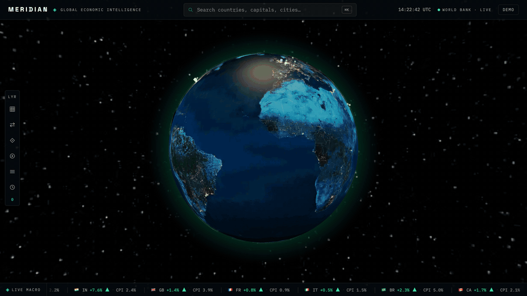
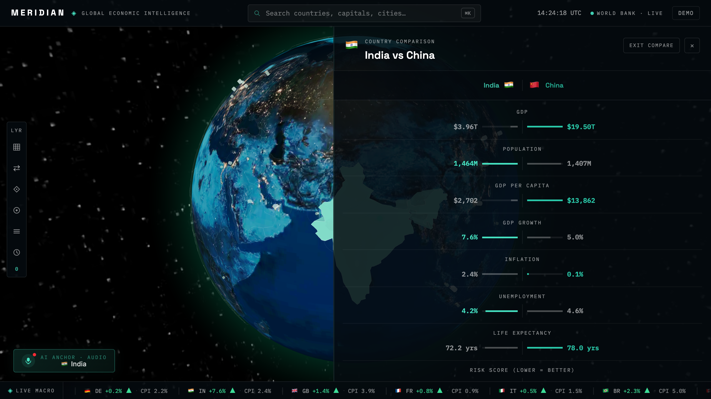
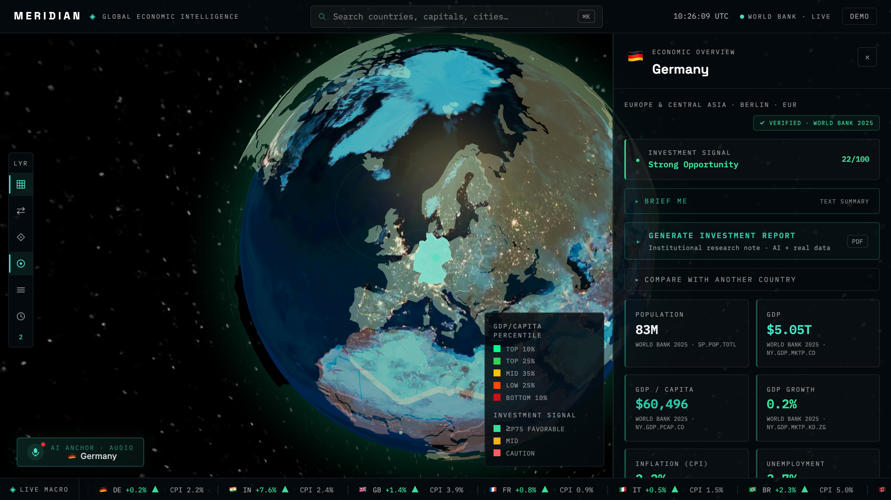
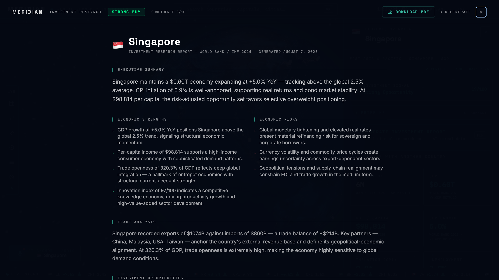
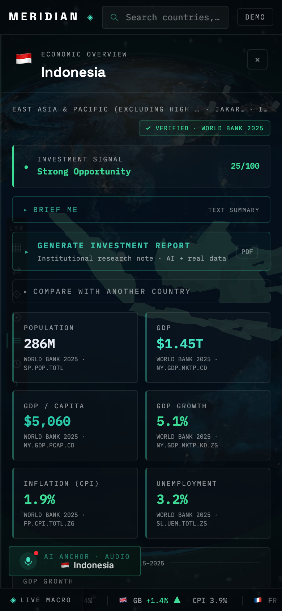
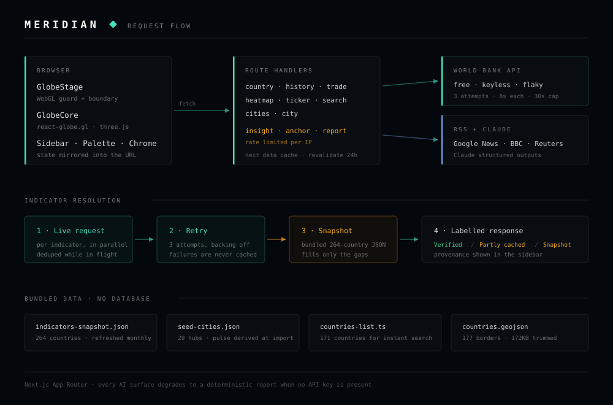

<div align="center">

# 🌍 Meridian

### Global Economic Intelligence, on a living 3D globe

Real World Bank indicators, live market news, and AI research notes —
in one interactive surface. No database. No cloud account. One optional API key.

[](https://github.com/lumixed/plateful/actions/workflows/ci.yml)


</div>

---

## Overview

Economic data is scattered. The World Bank has the numbers, newswires have the context, and
neither tells you where a country actually stands. **Meridian** pulls them into a single view:
spin the globe, click a country, and get a full macro dashboard — GDP, growth, inflation,
unemployment, trade balance, a ten-year trend, live business headlines, and an
institutional-style research note.

It is built to survive its own dependencies. The World Bank API is free and keyless, and it is
also genuinely unreliable — during development it returned sticky `502`s for specific
country/indicator pairs for minutes at a time. Meridian retries, caches, and falls back to a
bundled snapshot of 264 countries, then **tells you in the UI which source each number came
from**. Every AI surface degrades to a deterministic, data-derived report when no API key is
configured.

---

## Table of contents

- [Demo](#demo)
- [Key features](#key-features)
- [Architecture](#architecture)
- [Tech stack](#tech-stack)
- [Prerequisites](#prerequisites)
- [Getting started](#getting-started)
- [Environment variables](#environment-variables)
- [Scripts](#scripts)
- [Project structure](#project-structure)
- [Reliability](#reliability)
- [Accessibility](#accessibility)
- [Performance](#performance)
- [Testing](#testing)
- [Deployment](#deployment)
- [Known limitations](#known-limitations)
- [Credits](#credits)
- [License](#license)

---

## Demo



*Opening the command palette, jumping to Brazil, then switching on the GDP-per-capita heatmap and
trade-route layers. Every figure on screen is live World Bank data.*

<table>
<tr>
<td width="50%"></td>
<td width="50%"></td>
</tr>
<tr>
<td align="center"><sub><b>Country comparison</b> — bars grow from the centre, with a composite verdict</sub></td>
<td align="center"><sub><b>Intelligence layers</b> — percentile heatmap and investment signal</sub></td>
</tr>
<tr>
<td width="50%"></td>
<td width="50%" align="center"></td>
</tr>
<tr>
<td align="center"><sub><b>Investment report</b> — full research note with printable PDF export</sub></td>
<td align="center"><sub><b>Responsive</b> — full-width dashboard on phones</sub></td>
</tr>
</table>

---

## Key features

| | Feature | What it does |
|---|---|---|
| 🌐 | **Interactive 3D globe** | Click any of 177 countries for a full economic dashboard. Radar-ring selection markers, city pulse rings, and auto-rotate that yields to interaction. |
| 📊 | **Real World Bank data** | GDP, growth, GDP per capita, CPI inflation, unemployment, life expectancy, exports/imports/balance — free API, no key required. |
| 🛡️ | **Honest data provenance** | Every reading is labelled `Verified`, `Partly cached`, or `Cached snapshot`, so you always know whether a number came from the live API. |
| 📰 | **Live economic news** | Google News, BBC, Reuters and country-specific RSS feeds, ranked by freshness × source quality and filtered to the last 72 hours. |
| 🧠 | **AI research notes** | A Managing-Director-style investment note with recommendation, sector signals and confidence score — grounded in the metrics on screen. |
| 🎙️ | **AI news anchor** | An on-air briefing read aloud through the Web Speech API. No external TTS service. |
| ⚖️ | **Country comparison** | Side-by-side macro dashboards with a composite investment verdict and point spread. |
| 🗺️ | **Intelligence layers** | GDP/capita percentile heatmap, animated bilateral trade routes, city corridors, investment-signal overlay, and a 2015–2025 timeline. |
| ⌘ | **Command palette** | `⌘K` / `Ctrl K` to jump to any country, capital or city, or toggle any layer — fully keyboard-driven. |
| 🔗 | **Shareable deep links** | Selection, comparison, layers and timeline year all live in the URL: `?c=IN&vs=CN&layers=heatmap,news` |
| 🎬 | **Demo mode** | An auto-cycling tour of six major economies, for when you want it to present itself. |

---

## Architecture



The interesting part is the middle band — **how a single indicator is resolved**:

1. **Live request.** Seven indicators fire in parallel per country. Identical in-flight requests are deduped.
2. **Retry.** Three attempts with backoff, each capped at 8s, the whole chain capped at 30s. A failed lookup is *never* written to the cache, so a blip cannot blank a country for 24 hours.
3. **Snapshot.** Anything still missing is filled per-indicator from a bundled 264-country JSON.
4. **Labelled response.** The sidebar badge reports which of those paths produced the numbers.

Successful lookups go through Next.js's data cache with a 24-hour revalidate, so caching survives
serverless cold starts — an in-memory map would not.

---

## Tech stack

| Layer | Choice | Why |
|---|---|---|
| Framework | **Next.js 16** (App Router) | Route handlers, streaming responses, and the fetch data cache in one runtime |
| UI | **React 19** + **TypeScript 5** | Strict mode throughout, no `any` in application code |
| Styling | **Tailwind CSS v4** | Utility-first, over a small `@layer components` design system |
| 3D | **react-globe.gl** / **three.js** | WebGL globe with polygon, arc, point and ring layers |
| Motion | **Framer Motion** | Panel transitions and staged reveals |
| AI | **Anthropic Claude** | Schema-enforced structured outputs — no prompt-prefill JSON hacks |
| Testing | **Vitest** + **Testing Library** | A node project for logic, a jsdom project for components |
| Data | World Bank Open Data · Natural Earth · RSS | All free, all keyless |

---

## Prerequisites

- **Node.js 22 or newer** — check with `node --version`
- **npm 10+** (ships with Node 22)
- A **WebGL-capable browser**. Without one the app detects the gap and shows a usable fallback rather than a blank screen.
- *Optional:* an [Anthropic API key](https://console.anthropic.com/settings/keys) for the AI surfaces. Everything else works without one.
- *Optional, for `npm run capture`:* Google Chrome and `ffmpeg` on your `PATH`.

---

## Getting started

**1. Clone and install**

```bash
git clone https://github.com/lumixed/plateful.git
```

```bash
cd plateful && npm install
```

**2. Configure the environment** *(optional — the app runs without it)*

```bash
cp .env.example .env.local
```

Leave the file untouched for a fully working, keyless build. Add `ANTHROPIC_API_KEY` if you want
Claude-generated briefings instead of the deterministic fallbacks.

**3. Start the dev server**

```bash
npm run dev
```

**4. Open [http://localhost:5320](http://localhost:5320)**

Give the globe a few seconds to boot, then press `⌘K` and type a country name.

**5. Verify everything before you commit**

```bash
npm run lint && npx tsc --noEmit && npm test && npm run build
```

---

## Environment variables

| Variable | Required | Default | Purpose |
|---|---|---|---|
| `ANTHROPIC_API_KEY` | No | — | Enables Claude briefings, research notes and the anchor script. Without it, every AI surface renders a deterministic report built from the same real data. |
| `CLAUDE_MODEL` | No | `claude-opus-5` | Set `claude-haiku-4-5` for cheaper, faster briefings. |
| `NEXT_PUBLIC_SITE_URL` | No | `http://localhost:5320` | Canonical origin for Open Graph tags. **Set this in production** or link previews break. |

---

## Scripts

| Command | What it does |
|---|---|
| `npm run dev` | Dev server on port 5320 |
| `npm run build` | Production build |
| `npm start` | Serve the production build |
| `npm run lint` | ESLint — zero warnings enforced in CI |
| `npm test` | Vitest, both projects |
| `npm run snapshot` | Rebuild the offline indicator snapshot from the World Bank |
| `npm run trim-geo` | Re-trim `countries.geojson` after replacing the source file |
| `npm run capture` | Regenerate the demo GIF and screenshots in `docs/` |

---

## Project structure

```
src/
  app/
    api/              Route handlers — country, news, trade, history, heatmap,
                      ticker, search, cities, insight (streaming), anchor, report
    opengraph-image   Social card, generated at build time
  components/
    Globe/            WebGL scene, capability guard, error boundary, arc data
    Sidebar/          Country, city, comparison and investment-report panels
    UI/               Top bar, ticker, layer rail, command palette, anchor, timeline
  lib/
    worldbank.ts      Indicator client: retry, dedupe, deadline, snapshot fallback
    country-meta.ts   Country metadata and sovereign-code list
    news-scoring.ts   RSS parsing and freshness × source-quality ranking
    rate-limit.ts     Per-IP token buckets for the AI routes
    scores.ts         Risk and innovation composites
  data/               Country list, city hubs, indicator snapshot, territory notes
  hooks/              useUrlState (deep links), useDialog (focus trap), useCountUp
scripts/              Snapshot builder, geojson trimmer, demo capture
docs/                 Architecture diagram, demo GIF, screenshots
```

---

## Reliability

The World Bank API is the one upstream that matters, and it fails in awkward ways — not outright
downtime, but sticky `502`s scoped to a single country and a single indicator. Meridian handles
that in layers:

- **Retry** — 3 attempts, 8s each, with backoff
- **Deadline** — the whole chain is capped at 30s, so a hung socket can never pin a request forever
- **Negative results are never cached** — only successful lookups are memoised
- **Per-indicator snapshot fallback** — gaps are filled individually, not all-or-nothing
- **Provenance in the UI** — the badge tells the truth about where each number came from

Refresh the offline snapshot whenever you like:

```bash
npm run snapshot
```

It makes seven bulk calls — one per indicator, not one per country — so it finishes in seconds.
A GitHub Action re-runs it monthly and opens a PR if the data has moved.

---

## Accessibility

Lighthouse scores **100** for accessibility. Concretely:

- Every surface is keyboard-reachable; `⌘K` drives navigation and layers without touching the globe
- Dialogs trap focus, close on `Escape`, and restore focus to their trigger
- Streaming AI text and the news feed are `aria-live` regions
- Informational text sits at or above **4.96:1** contrast against the page background; only non-informational dividers fall below
- `prefers-reduced-motion` disables the ticker marquee and blinking cursors

---

## Performance

Lighthouse, desktop preset, against a production build:

| Category | Score |
|---|---|
| Performance | **76** |
| Accessibility | **100** |
| Best Practices | **100** |
| SEO | **100** |

| Web vital | Value |
|---|---|
| First Contentful Paint | 0.2 s |
| Largest Contentful Paint | 1.3 s |
| Cumulative Layout Shift | 0 |
| Speed Index | 1.6 s |
| Total Blocking Time | 400 ms |

Static assets were cut from **~2.6 MB to 376 KB**: textures re-encoded to WebP at half resolution,
and `countries.geojson` reduced to two-decimal precision with unused properties stripped — 588 KB
down to 172 KB, and 56 KB over the wire.

The geometry itself is deliberately **not** simplified. Running it through a simplifier rewinds
polygon rings to RFC 7946 counter-clockwise order, which inverts every country fill on a sphere:
the whole globe renders solid, with a country-shaped hole in it.

Performance sits at 76 because Total Blocking Time is 400 ms. three.js and react-globe.gl are a
514 KB chunk that must parse and execute before the globe can draw. That is the honest cost of a
WebGL globe, and it is the main thing left to optimise.

---

## Testing

```bash
npm test
```

**78 tests** across two Vitest projects:

- **`lib`** (node) — scoring composites, city pulse maths, RSS parsing and freshness ranking, rate-limit buckets, and the full indicator-resolution path with `fetch` mocked to fail, hang, or partially succeed
- **`ui`** (jsdom) — `CountryView` loading / loaded / territory / retry states and provenance badges, plus the command palette's search, keyboard navigation and layer commands

---

## Deployment

Any Node host works. On Vercel:

1. Import the repository
2. Add `NEXT_PUBLIC_SITE_URL` (your production origin) and, optionally, `ANTHROPIC_API_KEY`
3. Deploy — no build configuration needed

---

## Known limitations

Being straight about what is not solved:

- **Rate limiting is per-instance.** The AI routes use in-memory token buckets, so on serverless each instance keeps its own count and the effective ceiling is higher than configured. It stops casual abuse, not a determined attacker. A shared store (Vercel KV / Upstash) would fix it, at the cost of the "no external services" property.
- **City metrics are estimates.** The 29 hubs carry illustrative figures, labelled `(Est.)` in the UI. National figures are the real data.
- **Risk and Innovation are invented composites**, derived from World Bank indicators and labelled as Meridian composites — they are not standard indices.
- **The bundled snapshot ages.** The monthly workflow keeps it current; a fork without Actions enabled will drift.
- **Total Blocking Time is 400 ms**, dominated by the WebGL bundle.

---

## Credits

Concept inspired by the MIT-licensed [PulseEarth](https://github.com/codedivaa/PulseEarth)
hackathon project, rebuilt from scratch on a leaner stack.

- Economic indicators — [World Bank Open Data](https://data.worldbank.org/)
- Country borders — [Natural Earth](https://www.naturalearthdata.com/)
- Globe textures — [three-globe](https://github.com/vasturiano/three-globe)
- News — Google News, BBC Business, Reuters, and country-specific publications

---

## License

[MIT](LICENSE) — see the file for third-party data and asset notices.
